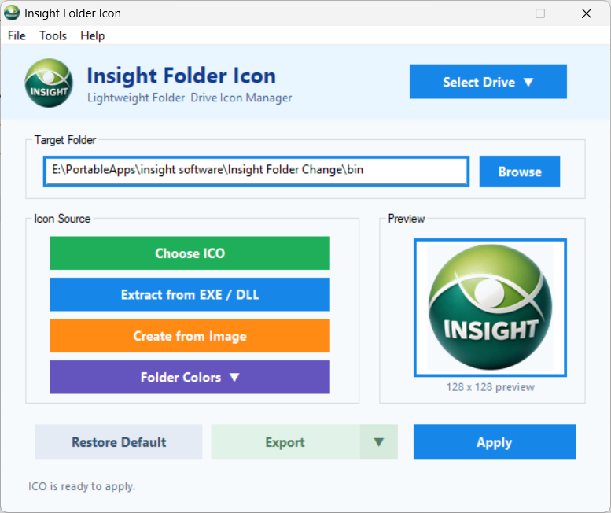
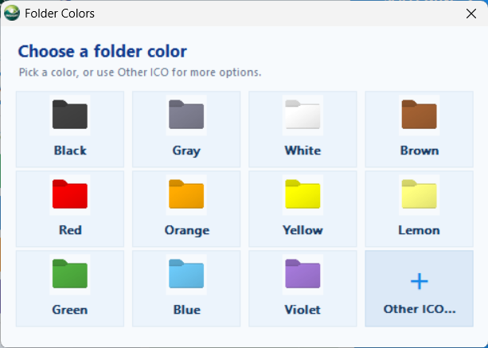
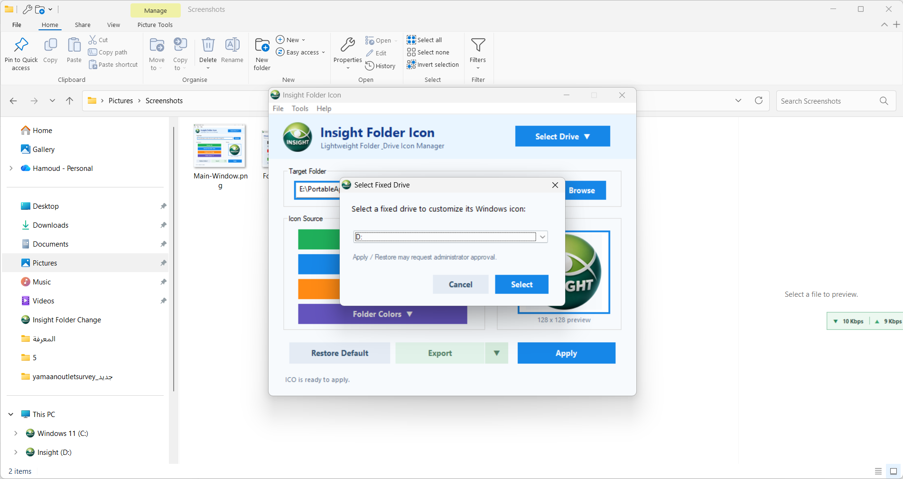

# Insight Folder Icon v1.13

**A lightweight, portable Windows utility for customizing folder and drive icons.**

Insight Folder Icon makes it easy to personalize folders and local drives through a simple, user-friendly interface.

## Download

**[⬇ Download Insight Folder Icon v1.13 for Windows](https://github.com/alarifi/Insight-Folder-Icon/releases/download/v1.13/Insight-Folder-Icon-v1.13-Windows.zip)**

Portable Windows application. No traditional installation required.

[View the latest release](https://github.com/alarifi/Insight-Folder-Icon/releases/latest)

## Screenshots

### Main Application

A compact interface for managing folder and drive icons, converting images, and previewing your selections.

  

### Folder Colors

Choose from 11 built-in folder colors or select your own custom ICO file.

  

### Custom Drive Icons

Personalize fixed-drive icons in Windows Explorer and restore their previous appearance when needed.

  

---

### Key Features
- Change and restore folder icons.
- Customize fixed-drive icons.
- Choose from 11 built-in folder colors.
- Convert PNG, JPG, BMP, and GIF images into multi-resolution ICO files.
- Extract icons from EXE and DLL files.
- Preview icons before applying them.
- Integrate with Windows Explorer's right-click menu.
- Export generated icons.
- Portable design with no traditional installation required.

### Requirements
- Windows 10 or Windows 11.
- Administrator approval may be required when changing drive icons.

### Installation
1. Download the Windows ZIP package below.
2. Extract it to a folder of your choice.
3. Run Insight Folder Icon.
4. Select a folder or drive, choose an icon, and click Apply.

**Developed by Insight Tools — Insight Research & Consulting.**
